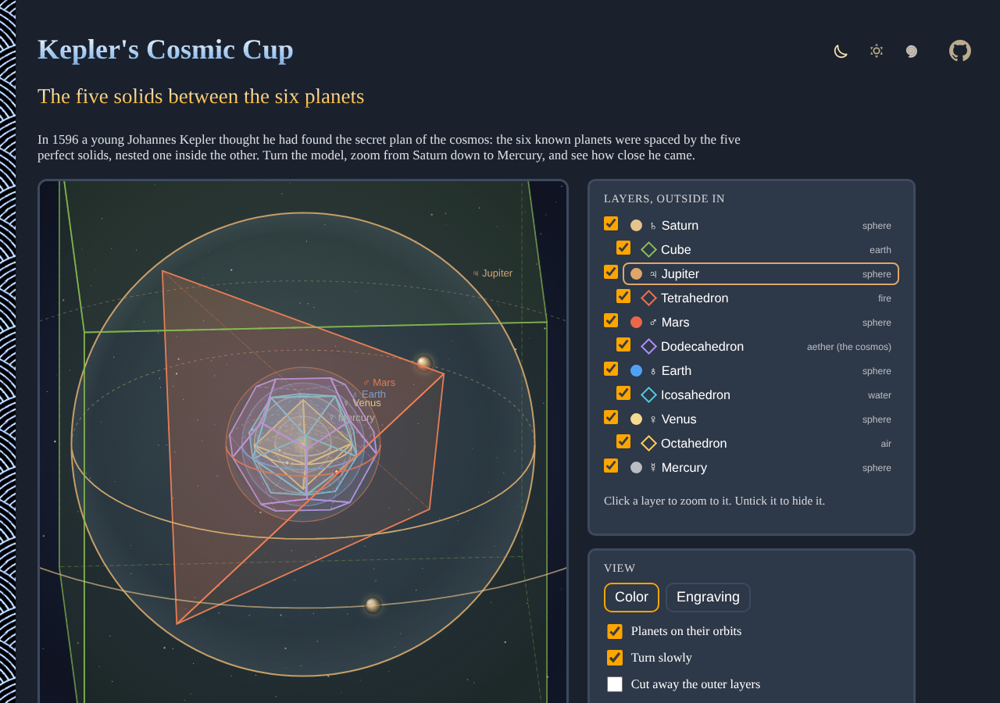

# Keplers-Cosmic-Cup

Kepler's *Mysterium Cosmographicum* (1596) in 3D, right in your browser: the five Platonic solids nested between the spheres of the six planets, from Saturn's sphere around a cube down to Mercury's inside an octahedron. Turn it, zoom through each layer, and compare Kepler's distances with the real ones.

- [Open the cosmic cup](https://evoluteur.github.io/keplers-cosmic-cup/)
- [About Kepler's model](https://evoluteur.github.io/keplers-cosmic-cup/about.html)

## What it does

- **3D model**: drag (or use the arrow keys) to turn the nest of spheres and solids. Each planet circles its sphere with its real relative period.
- **Zoom through the layers**: click a layer, use the zoom buttons, the mouse wheel or + and −, and the view glides from Saturn to Mercury. Outer layers fade away as you go in, or cut them away to look inside.
- **Kepler's thick shells**: switch from thin spheres at each planet's mean distance to shells as thick as its swing toward and away from the Sun, the way Kepler fit them. Choose whether Mercury's sphere sits inside the octahedron's faces or touches its edges, his fix for the worst fit.
- **How close did he come?**: tables of Kepler's ratios against the real ones, and of the distances from the Sun they predict, with the error for each.
- **Engraving style**: ink on old paper, after the famous plate of the book, or color in space. Save the view as a PNG.

## The geometry

Each solid fits between two spheres: one through its corners and one touching its faces. The ratio of the two is fixed by the shape: 1/√3 for the cube and octahedron, 1/3 for the tetrahedron and 0.795 for the dodecahedron and icosahedron. Starting from Saturn, every sphere follows from the one outside it.

## How it is built

The pages are plain HTML, CSS and JavaScript, with no dependencies and no build step. Just open `index.html`. It is also a small installable web app that works offline.

- The 3D view is drawn on a 2D canvas with a small projection: back faces first, outside in, then front faces, inside out.
- Only the corners of the solids are written down, in [js/solids.js](https://github.com/evoluteur/keplers-cosmic-cup/blob/main/js/solids.js); edges, faces and radii are computed.
- The app logic is in [js/cup.js](https://github.com/evoluteur/keplers-cosmic-cup/blob/main/js/cup.js).
- Three color themes (dark, light and blue) are shared with my other projects. Your view settings are kept in local storage.

## Open Source

Keplers-Cosmic-Cup is open source at [GitHub](https://github.com/evoluteur/keplers-cosmic-cup) with MIT license.

Had fun browsing the app? [Buy me a coffee by becoming a sponsor](https://github.com/sponsors/evoluteur).

You may also be interested in my other projects [Platonic-Solids](https://github.com/evoluteur/platonic-solids) ([demo](https://evoluteur.github.io/platonic-solids/)) and [Music-of-the-Spheres](https://github.com/evoluteur/music-of-the-spheres) ([demo](https://evoluteur.github.io/music-of-the-spheres/)). For more mystic arts as small web apps, see [Esoterica](https://evoluteur.github.io/esoterica.html).

Copyright (c) 2026 [Olivier Giulieri](https://evoluteur.github.io/).
